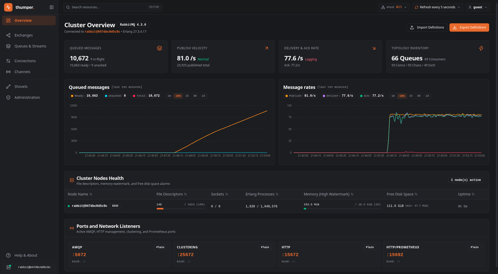
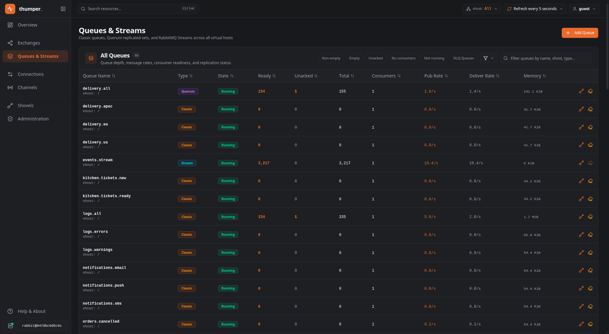
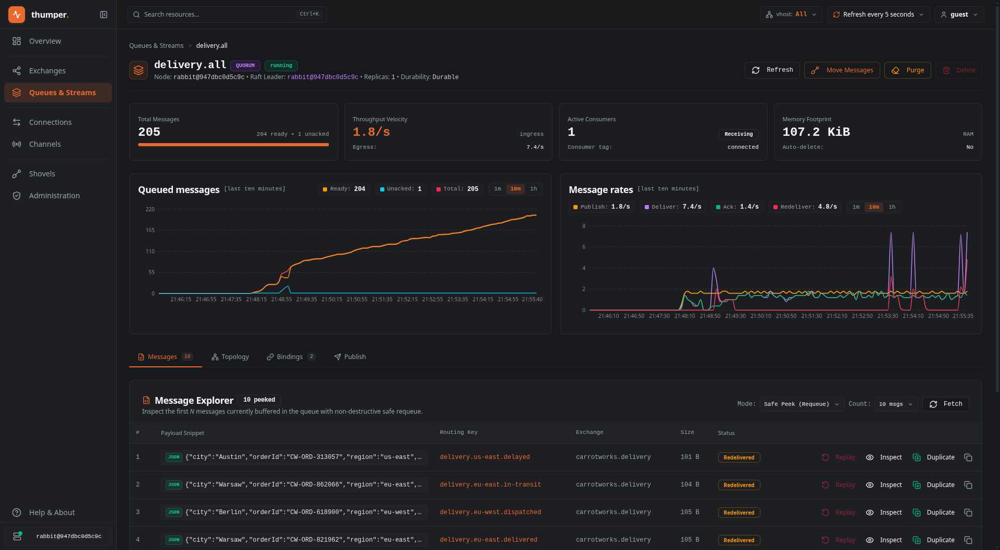
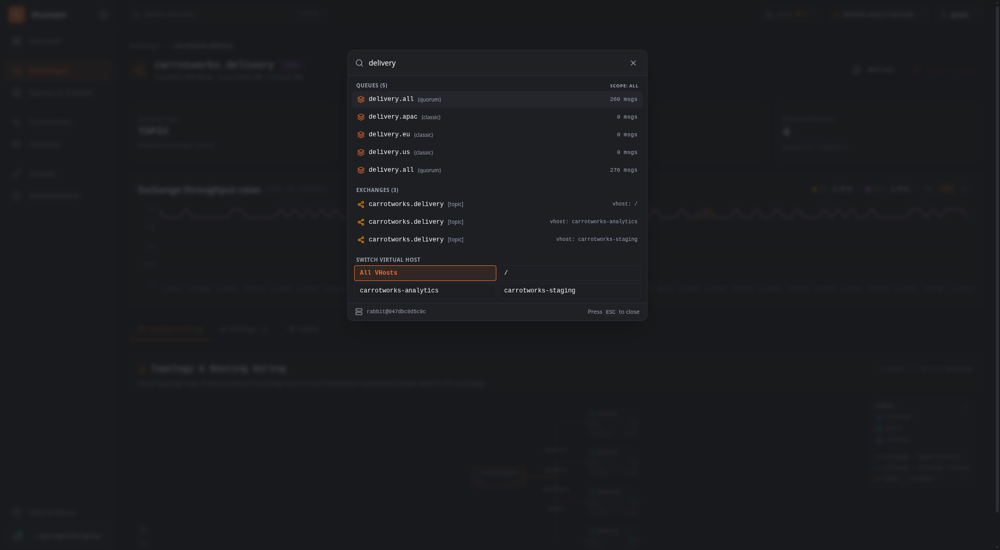

<p align="center">
  
</p>

<p align="center">
  <a href="LICENSE"></a>
  <a href="#"></a>
  <a href="#"></a>
  <a href="#"></a>
  <a href="docs/docker.md"></a>
</p>

<p align="center">
  <strong>The modern, high-performance management dashboard RabbitMQ deserves.</strong><br>
  Instant filtering, visual topology routing maps, live message inspection, and real-time operational telemetry.<br>
  Built with ❤️ directly on top of the RabbitMQ Management HTTP API — zero extra backend required.
</p>

<p align="center">
  <a href="#-built-with-love-for-rabbitmq">Why Thumper</a> •
  <a href="#-feature-tour">Feature Tour</a> •
  <a href="#-getting-started">Getting Started</a> •
  <a href="#%EF%B8%8F-tech-stack">Tech Stack</a> •
  <a href="#-license">License</a>
</p>


## 🐰 Built with Love for RabbitMQ

RabbitMQ is one of the most dependable, battle-tested message brokers in the world. It quietly powers architectures everywhere, scaling effortlessly through heavy workloads.

**Thumper** was born out of a genuine appreciation for RabbitMQ, and the belief that such an enduring broker deserves a modern, joyful management experience with the kind of tools developers and operators love:

- ⚡ **Zero Extra Infrastructure**: Built entirely on top of the RabbitMQ Management HTTP API you already run. Point it at your cluster and go — no separate database, no background daemons, and no sidecars.
- 🧭 **Intuitive Visual Hierarchy**: Real-time throughput charts, interactive routing topology maps, and instant filter presets make exploring exchanges, queues, and consumers feel natural and fast.
- 🛠️ **Helpful New Features**: Safe non-destructive message peeking with JSON formatting, syntax highlighting, and spotlight navigation (`Ctrl+K`) make everyday broker inspection a breeze.
- 🔒 **Cloud & Kubernetes Native**: Easily deploy right alongside your broker in Kubernetes. The built-in reverse proxy routes all requests internally, keeping broker ports private with zero CORS fuss.

---

## 📸 Feature Tour

### 📊 Real-Time Cluster Telemetry
Live throughput velocity (publish, deliver, acknowledge rates), queued message distribution, and cluster node health (memory high watermark, file descriptors, Erlang process allocation, and disk space limits) updated with sub-second responsiveness.

<p align="center">
  
</p>

---

### 📦 Queues & Streams at Scale
Manage Classic queues, Raft-replicated Quorum queues, and high-throughput RabbitMQ Streams with ease. Quickly isolate problem queues with instant filter pills (`Non-empty`, `Unacked`, `No consumers`, `DLQ Queues`).

<p align="center">
  
</p>

---

### 🔍 Deep Queue Inspection & Safe Message Peek
Safely inspect buffered payloads with syntax-highlighted JSON formatting, routing keys, headers, and redelivery flags. Re-publish or duplicate messages for debugging without disrupting in-flight traffic.

<p align="center">
  
</p>

---

### ⌨️ Spotlight Command Palette (`Ctrl+K` / `Cmd+K`)
Jump straight to any queue, exchange, shovel, or virtual host across large multi-tenant clusters in a few keystrokes.

<p align="center">
  
</p>

---

## 🚀 Getting Started

Run Thumper using Docker pointing to your RabbitMQ management API:

```bash
docker run -d -p 8080:8080 -e RABBITMQ_URL="http://rabbitmq:15672" thumper:latest
```

Open [http://localhost:8080](http://localhost:8080) and log in with your RabbitMQ credentials.

### Guides & Documentation

- 🐳 **[Docker & Compose Guide](docs/docker.md)** — Run with `docker run` or Docker Compose.
- ☸️ **[Kubernetes Guide](docs/kubernetes.md)** — Deployments, Services, and Ingress manifests.
- 💻 **[Local Development Guide](docs/development.md)** — Setting up local dev server, testing, and building from source.

---

## 🛠️ Tech Stack

- **React 19** + **TypeScript** (Strict mode)
- **TanStack Router, Query & Table** for client-side routing, caching, and data grids
- **Tailwind CSS 4** + **Radix UI** for accessible design
- **@xyflow/react** + **dagre** for interactive topology graphs
- **Recharts** for real-time metric visualizations
- **Vite** for optimized bundling

---

## 📄 License

Thumper is licensed under the [GNU Affero General Public License v3.0](./LICENSE) (AGPL-3.0). Free and open-source for operators, teams, and developers everywhere.
