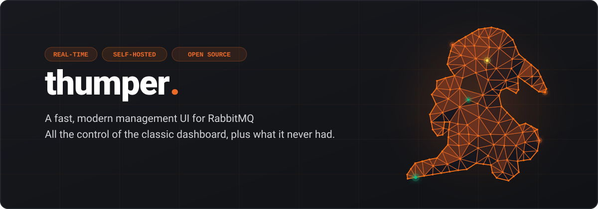

<p align="center">
  
</p>

<p align="center">
  <a href="LICENSE"></a>
  <a href="#"></a>
  <a href="#"></a>
  <a href="#"></a>
</p>

<p align="center">
  <strong>A fast, modern management UI for RabbitMQ.</strong><br>
  All the control of the classic dashboard, plus the tools it never had.
</p>

<p align="center">
  <a href="#-why-thumper">Why Thumper</a> •
  <a href="#-key-features">Features</a> •
  <a href="#-quick-start">Quick Start</a> •
  <a href="#%EF%B8%8F-tech-stack">Tech Stack</a> •
</p>

---

## 💡 Why Thumper?

RabbitMQ's built-in management UI has barely changed in over a decade. It works, but nested collapsible tables, static hour-long charts, and a UI that fights you at every click aren't exactly a joy to operate during an incident.

**Thumper** is a modern replacement for it, built on the same RabbitMQ HTTP API you already have. It covers the same ground — queues, exchanges, connections, users, policies — and adds the things the classic UI never got around to:

- ⚡ **Built for speed**: A modern React SPA instead of server-rendered pages, so navigating, filtering, and refreshing feels instant.
- 🧭 **Designed for operators**: Clear visual hierarchy, health scoring, and topology graphs replace walls of numbers — so you can spot the problem in seconds, not minutes.
- 🔌 **No backend to run**: Thumper only needs the RabbitMQ management API. Point it at your broker and go — no extra database, no extra service.

---

## ✨ Key Features

- 📊 **Live Cluster Overview** — queued messages, publish/ack rates, topology inventory, and node health at a glance, with zoomable real-time charts.
- 🗺️ **Visual Topology Graphs** — see exchange → binding → queue routing as an interactive graph instead of reading a table.
- 📦 **Queues & Streams** — Classic, Quorum, and Stream queue support with health scoring, consumer starvation alerts, and storage breakdowns.
- 🔀 **Exchanges** — create, inspect, and test-publish messages with a rich payload editor and routing-key simulator.
- 🔗 **Connections & Channels** — spot blocked or flow-throttled connections instantly, with per-client grouping and force-close controls.
- 🛠️ **Shovels, Policies & Limits** — manage dynamic shovels, operator/user policies, and vhost/user limits from clean, guided forms.
- 👤 **Users, VHosts & Permissions** — full admin surface for multi-tenant clusters, with regex permission testing built in.
- 📤 **Definitions Import/Export** — back up or migrate your entire broker configuration in a couple of clicks.
- 🌗 **Light & Dark Mode** — a polished theme either way, so it fits right into your NOC wall or your terminal-dark laptop.
- ⌨️ **Command Palette** — jump straight to any queue, exchange, or vhost with `Ctrl+K` / `Cmd+K`.

---

## ⚡ Quick Start

### 1. Start a RabbitMQ broker (or point Thumper at your existing one)

A ready-to-use broker with the management plugin is included:

```bash
docker compose up -d
```

This starts RabbitMQ on `localhost:5672` (AMQP) and `localhost:15672` (management API), with default credentials `guest` / `guest`.

### 2. Install dependencies

```bash
pnpm install
```

### 3. Run the dev server

```bash
pnpm dev
```

Open [http://localhost:5173](http://localhost:5173) and log in with your RabbitMQ credentials. In dev mode, requests to `/api` are proxied straight to `http://localhost:15672`.

### 4. Build for production

```bash
pnpm build
pnpm preview
```

Thumper builds to static files — serve them from any web server or CDN, in front of your RabbitMQ management API.

---

## 🛠️ Tech Stack

Thumper is a single-page app with no backend of its own:

- **React 19** + **TypeScript** for the UI
- **TanStack Router / Query / Table** for routing, data fetching, and data grids
- **Tailwind CSS 4** + **Radix UI primitives** for a fast, accessible design system
- **@xyflow/react** + **dagre** for interactive topology graphs
- **Recharts** for real-time metric charts
- **Vite** for dev server and bundling

---

## 📄 License

Thumper is licensed under the [GNU Affero General Public License v3.0](./LICENSE) (AGPL-3.0) — free and open source. If you modify Thumper and run it as a network service, you must make the source of your version available to its users under the same license. Want to use it under different terms (e.g. embed it in a closed-source product)? Open an issue to discuss a commercial license.
