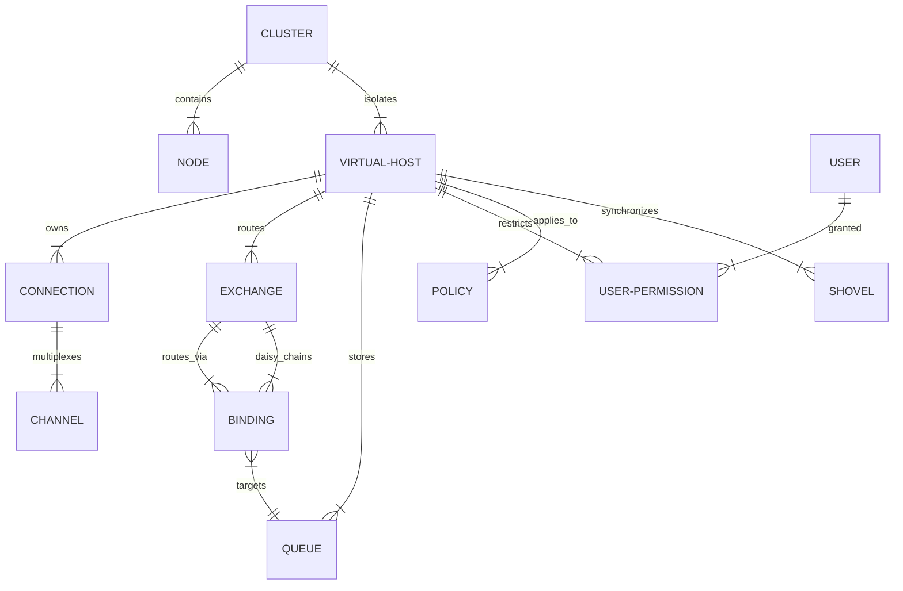

# RabbitMQ Management UI Feature Specification & Modern UI Blueprint

## Overview

This documentation suite provides a complete, exhaustive reverse-engineered specification of the classic RabbitMQ Management UI based on reference screenshots in [`reference/screenshots`](file:///home/nauer/Area51/rabbitdash/reference/screenshots).

The objective is to establish a 100% complete inventory of every feature, metric, configuration parameter, and action present in the original dashboard, and use this foundation to architect an enhanced, modern, high-performance UI (**RabbitDash**).

---

## Documentation Structure

| Document | Description |
| :--- | :--- |
| **[01. Reference Screenshot Audit](file:///home/nauer/Area51/rabbitdash/docs/reference-audit.md)** | Direct mapping of each screenshot (`login.png`, `1.png` - `17.png`) to screen types, sections, widgets, tables, and actions. |
| **[02. Authentication & Login Spec](file:///home/nauer/Area51/rabbitdash/docs/feature-specs/00-authentication-and-login.md)** | Login screen, Basic Auth verification via `/api/whoami`, multi-cluster profile connections, and role-based permissions. |
| **[03. Global & Navigation Spec](file:///home/nauer/Area51/rabbitdash/docs/feature-specs/01-global-and-navigation.md)** | Header, global vhost filter, auto-refresh engine, cluster banner, user auth/logout, and footer metadata. |
| **[04. Overview Screen Spec](file:///home/nauer/Area51/rabbitdash/docs/feature-specs/02-overview.md)** | Totals charts, message rate breakdowns, global counts, cluster node health, churn statistics, ports & contexts, broker definition export/import. |
| **[05. Connections & Channels Spec](file:///home/nauer/Area51/rabbitdash/docs/feature-specs/03-connections-and-channels.md)** | Connection table & details (client properties, network rates, force close), Channel table & details (prefetch, unacked, raft commands, Erlang VM stats). |
| **[06. Exchanges Spec](file:///home/nauer/Area51/rabbitdash/docs/feature-specs/04-exchanges.md)** | Exchange types, listing, creation form with arguments, exchange details, bindings graph/table, test message publisher, and deletion. |
| **[07. Queues & Streams Spec](file:///home/nauer/Area51/rabbitdash/docs/feature-specs/05-queues-and-streams.md)** | Queue types (Classic, Quorum, Stream), queue listing, creation wizard with argument presets (TTL, DLX, max-length), queue details (memory/storage breakdown, peek/get messages, shovel mover, purge, delete). |
| **[08. Admin & Cluster Spec](file:///home/nauer/Area51/rabbitdash/docs/feature-specs/06-admin.md)** | User management & tags, vhost & topic permissions (regex), Virtual Hosts, Feature Flags, Policies & Operator Policies, VHost & User Limits, Cluster renaming, Dynamic Shovels. |
| **[09. Feature Matrix & Modern UI Opportunities](file:///home/nauer/Area51/rabbitdash/docs/feature-matrix.md)** | Comprehensive capability matrix comparing Old UI feature vs API requirement vs Modern UI UX improvements. |
| **[10. Modern UI Architecture & Screen Plan](file:///home/nauer/Area51/rabbitdash/docs/modern-ui-architecture.md)** | Proposed screen layout, component hierarchy, tech stack recommendations, interactive visualizations (bindings topology, real-time charts), and workflow enhancements. |

---

## Core Domain Model Summary

---

## Key Principles for the Modern UI ("RabbitDash")

1. **Feature Parity Guarantee**: No capability, diagnostic metric, or operational tool from the classic management UI will be omitted.
2. **Superior UX & Visual Hierarchy**: Replace the antiquated 2010-era nested collapsible tables with clean cards, interactive data grids with column sorting/pinning, search-as-you-type, and dedicated drawer/modal editors.
3. **Interactive Observability**: Upgrade static 1-hour line charts to zoomable, high-resolution time-series graphs with customizable windows (1m, 5m, 1h, 24h) and live streaming updates.
4. **Developer Quality of Life**:
   - Syntax-highlighted JSON/YAML editors (e.g. Monaco) with schema validation for payload publishing and policy creation.
   - Message inspection with pretty-printing, hex viewer, and one-click redelivery / clone.
   - Visual DAG graph for Exchange $\to$ Binding $\to$ Queue message flow.
   - Global command palette (`Cmd+K` / `Ctrl+K`) for lightning-fast jumping between queues, exchanges, and vhosts.
